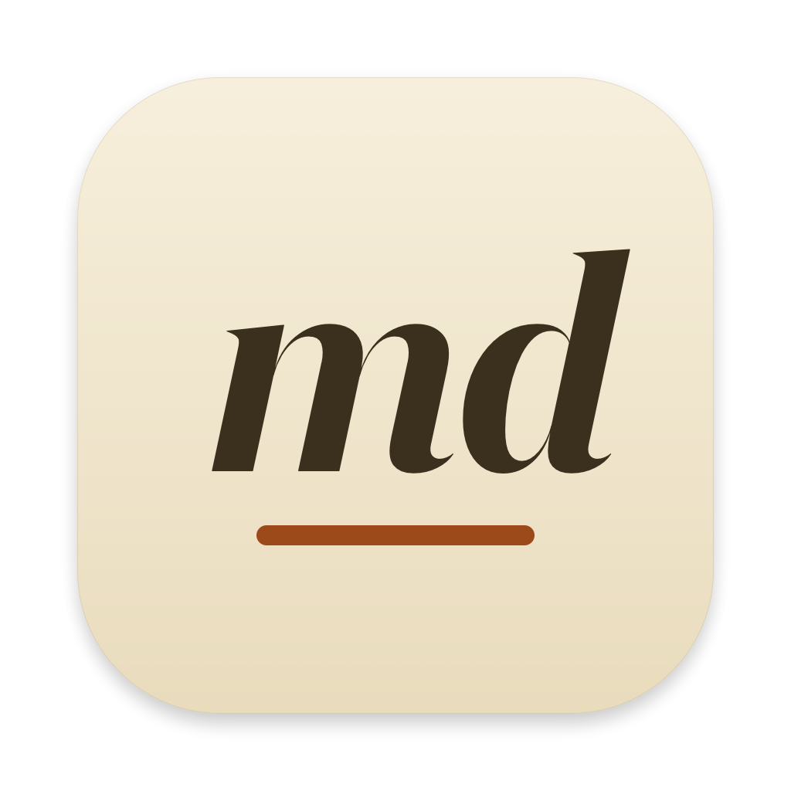
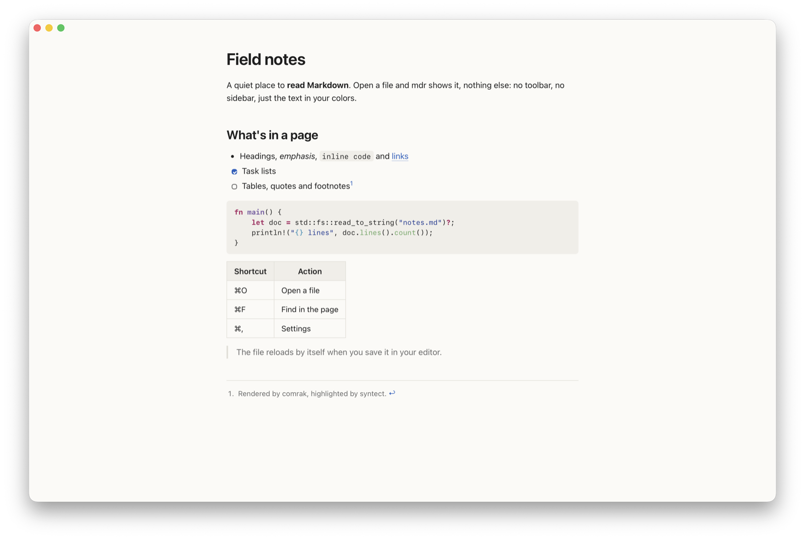
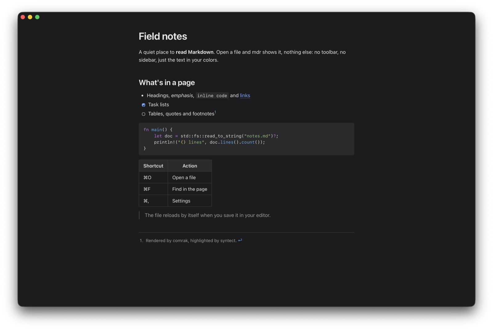
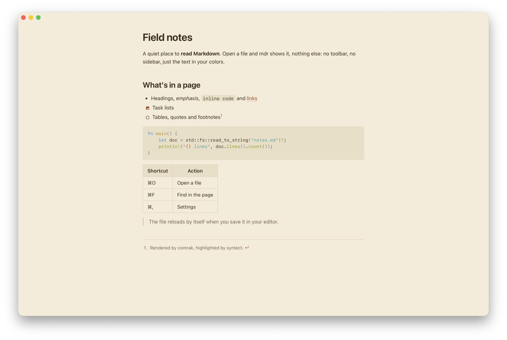

<p align="center"></p>

# mdr

A minimal, read-only Markdown viewer for macOS. One file per window, a solid background, no chrome: just the text, in your colors.

<p align="center">
  
  
  
</p>

- **GitHub Flavored Markdown**: tables, task lists, footnotes, strikethrough, autolinks, raw HTML (sanitized).
- **Syntax highlighting** for code blocks, in colors that follow your theme.
- **Live reload**: the page follows your editor's saves and keeps its scroll position.
- **Your colors and fonts**, from a Settings window or a plain `config.toml`, applied instantly.
- **Find in the page** (⌘F), zoom, local images, links between Markdown files.
- **Native and light**: Rust and [Tauri 2](https://tauri.app) on the system WebView, a 6 MB app. See [performance](docs/performance.md).

## Install

1. Download `mdr_<version>_aarch64.dmg` from the [latest release](https://github.com/timothee-faget/mdr/releases/latest) (Apple Silicon Macs only).
2. Open it and drag **mdr** to **Applications**.
3. mdr is not signed with an Apple Developer ID, so macOS blocks its first launch. Allow it once, either:
   - open mdr, dismiss the warning, then go to **System Settings › Privacy & Security** and click **Open Anyway** next to the message about mdr;
   - or run `xattr -dr com.apple.quarantine /Applications/mdr.app` in a terminal.

### Make mdr the default for Markdown files

mdr appears in the Finder's **Open With** menu for `.md`, `.markdown`, `.mdown`, `.mkd` and `.mkdn` files, but doesn't take over on its own. To open every Markdown file with it:

1. Select a `.md` file in the Finder and press **⌘I** (Get Info).
2. Under **Open with**, choose **mdr**.
3. Click **Change All…** and confirm.

Repeat with a `.markdown` file if you use that extension too.

### The `mdr` command

Open files from the terminal: `mdr README.md`, `mdr docs/*.md`, or `mdr` alone to bring mdr to the front.

```sh
mkdir -p ~/.local/bin
curl -fsSL https://raw.githubusercontent.com/timothee-faget/mdr/main/scripts/mdr -o ~/.local/bin/mdr
chmod +x ~/.local/bin/mdr
```

`~/.local/bin` must be in your `PATH`. From a clone of the repository, `just install-cli` does the same.

## Use

- **Open a file** by double-clicking it (once mdr is the default), with **Open With › mdr**, by dropping it on mdr's Dock icon, with **File › Open…** (⌘O), or with `mdr file.md`. Each file gets its own window, and opening a file again brings its window to the front.
- **Edit it in any editor**: mdr reloads it on every save. If you were at the end of the page, it follows the end.
- **Links**: web and mail links open in your browser and mail app; links to other Markdown files open them in mdr; `#anchors` scroll the page.
- **Images** next to the document (``) are shown. The first time a document in `~/Documents`, `~/Desktop` or `~/Downloads` shows images, macOS asks whether mdr may read that folder.
- **Find**: ⌘F, then Enter / ⇧Enter (or ⌘G / ⇧⌘G) to move between matches, Esc to close.

### Keyboard shortcuts

| Shortcut | Action |
|---|---|
| ⌘O | Open a file |
| ⌘W | Close the window |
| ⌘, | Settings |
| ⌘F | Find in the page |
| ⌘G / ⇧⌘G | Next / previous match |
| ⌘C / ⌘A | Copy / select all |
| ⌘= / ⌘− / ⌘0 | Zoom in / zoom out / actual size |
| ⌘R | Reload the document |
| ⌃⌘F | Full screen |
| ⌘M / ⌘H / ⌘Q | Minimize / hide / quit |

**File › Reveal in Finder** shows the document's file, **File › Open Config File** opens the configuration.

## Configure

Open **mdr › Settings…** (⌘,) to pick the appearance, the light and dark themes, their colors, the font, the text size and the column width. Every change is saved to the configuration file at once and applied to the open windows.

The configuration file is `~/.config/mdr/config.toml` (or `$XDG_CONFIG_HOME/mdr/config.toml`). You can also edit it by hand, from **File › Open Config File**, which creates it with every option commented out. mdr applies it as soon as the file is saved, and the Settings window keeps your comments and formatting when it edits the file.

### Reference

Every key is optional.

| Key | Default | Values |
|---|---|---|
| `appearance` | `"auto"` | `"auto"` follows macOS, `"light"`, `"dark"` |
| `light_theme` | `"paper"` | a built-in theme or a `[themes.<name>]` |
| `dark_theme` | `"night"` | a built-in theme or a `[themes.<name>]` |
| `font.family` | `"-apple-system, system-ui, sans-serif"` | a CSS font-family list |
| `font.mono` | `"ui-monospace, SF Mono, Menlo, monospace"` | a CSS font-family list, for code |
| `font.size` | `16` | text size in pixels, 8 to 48 |
| `font.line_height` | `1.6` | 1.0 to 3.0 |
| `layout.max_width` | `"70ch"` | column width: `ch`, `px`, `em`, `rem` or `%` |

A `[themes.<name>]` table defines a theme, or overrides some colors of a built-in one when it has its name (`[themes.paper]`):

| Key | What it colors |
|---|---|
| `background` | the page |
| `text` | the text |
| `muted` | quotes, footnotes, secondary text |
| `accent` | links, checked tasks, search matches |
| `code_background` | code blocks and inline code |
| `border` | tables, separators, quotes |
| `code_theme` | syntax highlighting (see below) |

Colors are `#rgb`, `#rrggbb`, `#rrggbbaa`, `rgb(r, g, b)` or `rgba(r, g, b, a)`. Unset colors of a custom theme come from `paper`.

### Built-in themes

| Theme | Background | Text | Accent | Code theme |
|---|---|---|---|---|
| `paper` | `#fbfaf7` | `#1f1f1f` | `#1f5fbf` | `InspiredGitHub` |
| `sepia` | `#f4ecd8` | `#3b2f1e` | `#9c4a1a` | `Solarized (light)` |
| `night` | `#1c1c1e` | `#e4e4e6` | `#6eaaff` | `OneHalfDark` |

Code themes: `1337`, `base16-eighties.dark`, `base16-mocha.dark`, `base16-ocean.dark`, `base16-ocean.light`, `Catppuccin Frappe`, `Catppuccin Latte`, `Catppuccin Macchiato`, `Catppuccin Mocha`, `Coldark-Cold`, `Coldark-Dark`, `DarkNeon`, `Dracula`, `GitHub`, `gruvbox-dark`, `gruvbox-light`, `InspiredGitHub`, `Monokai Extended`, `Monokai Extended Bright`, `Monokai Extended Light`, `Monokai Extended Origin`, `Nord`, `OneHalfDark`, `OneHalfLight`, `Solarized (dark)`, `Solarized (light)`, `Sublime Snazzy`, `TwoDark`, `zenburn`.

### Example

```toml
appearance = "auto"
light_theme = "linen"
dark_theme = "night"

[font]
family = "Iowan Old Style, Georgia, serif"
size = 18

[layout]
max_width = "65ch"

# A custom light theme: unset colors come from paper.
[themes.linen]
background = "#f6f1e7"
text = "#2b2620"
accent = "#8a3b12"
code_theme = "gruvbox-light"

# A touch of color for the built-in dark theme.
[themes.night]
accent = "#ff9f43"
code_theme = "Dracula"
```

A mistake in the file never stops mdr: an invalid value falls back to its default, and a file that isn't valid TOML keeps the previous configuration. To see what was ignored, launch mdr from a terminal with `/Applications/mdr.app/Contents/MacOS/mdr`: the warnings appear there.

## Development

See [CONTRIBUTING.md](CONTRIBUTING.md). Performance is measured with `just bench`, see [docs/performance.md](docs/performance.md).

## License

[MIT](LICENSE)
